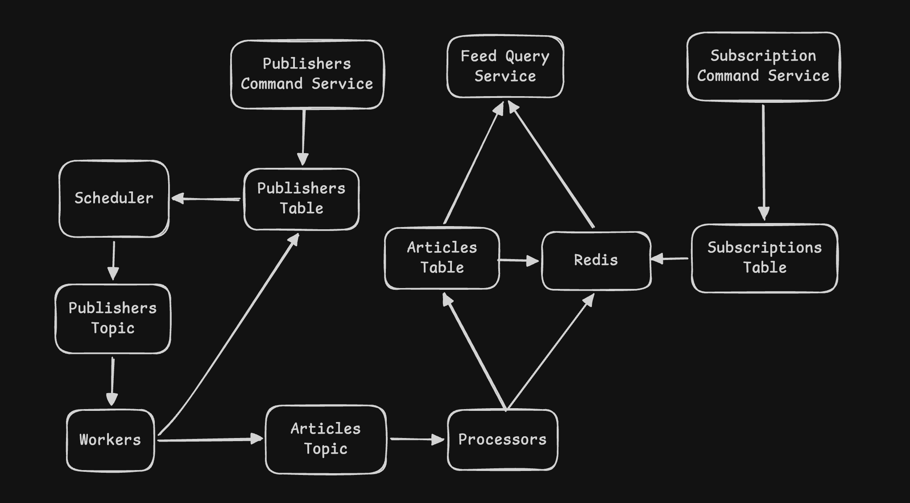

## News Aggregator (Google News / Feedly)

### Requirements

- thousands of publishers
- each one has an api (or rss) that returns its latest ~25 articles
- the user clicks through to the publisher's site
  - this probably means we only need to store metadata - title, summary, image, link, publish time, and not the content necessarily
- users follow "categories" (sports, tech) or "publishers"
- show each user a personalized, paginated feed

### Non Functional Requirements

- 50k publishers, 100 articles per day = 5M per day or write is 50qps
- 1M DAU, assume 100k concurrent reads qps at peak
- because of these numbers scale - postgres can serve the writes, while reads need redis / cache
- p95 -
  - feed should load quickly (within 1 second)
  - new articles should be visible in feed in 5-10 mins
- maybe point out eventual consistency, low latency, scalable reads, etc

### APIs

- GET /v1/feed?cursor=cursor&limit=20 -> { articles[], next_cursor }
- POST /v1/subscriptions/categories/(category_id) - create a user - category subscription
- POST /v1/subscriptions/publishers/(publisher_id) - create a user - publisher subscription

### Entities (Postgres)

- publishers
  - id - primary key
  - next_poll - index to query which ones to poll next
- articles
  - id - (primary key), external_id, title, url, etc
- article_category - article_id, category_id
- subscriptions - user_id, category_id, feed_id

### Entities (Redis)

- `cat:{id}` and `pub:{id}` - sorted set, article_id scored by published_at. Keep the last ~1000 items or 7 days
- `art:{id}` - hash with the article's metadata
- `subs:{user}` - the user's subscriptions

### Ingestion Flow

- "scheduler" - sees the publisher table, sees which ones are due, the ones to query to a kafka topic
- it also sets the next_poll for these publishers to say 5 mins more
- "workers" - reads from the kafka topic, queries the publishers feeds, writes the articles to another kafka topic
- stop paging through the external feed when the cursor sees an article that was already seen before
- it also sets the next poll at for the feeds
- "adaptive polling" - if a site is busy and returning too many new articles, start polling it more frequently (halve it). if however there are no changes, poll it less frequently (double it). accordingly update the postgres table to set the next_poll etc
- have client side rate limiting per server to avoid bombarding
- use retries, exponential backoff, jitter, etc
- recall how we used sqs in [web crawler](/posts/high-level-design-v/#web-crawler) - this helped us set visibility timeout for retries etc instead of performing retries in memory for bad workers
  - option 1 - so, we can instead set a visibility timeout for the message by using sqs
  - option 2 - write the next_poll in the postgres table to next_poll + backoff
- use "etags" - provide a version of the content under the header "if none match". this version i guess is called an etag. if nothing has changed, the origin server returns "304 not modified", thus saving bandwidth
- "processors" - reads from this articles kafka topic, updates the database, performs deduping etc, writes to articles table and redis as well
- processors also determine the category tags for an article and tag it accordingly
- it might happen multiple feeds have the same articles. dedupe them using techniques like "locality sensitive hashing" on the title, url, etc of the article
- when performing such deduping etc, we only need to check say the last 2 days of articles, older ones need not be checked
- we can use retries, and consumers should be idempotent to avoid writing the same articles twice
- for thumbnails, use s3, cdn, etc
- finally mention generic scaling stuff like scale based on metrics, connections, kafka topic lag, etc

### Feed Flow

- we use "fan out on read" only, no fan out on write -
  - users follow categories and feeds
  - each of them can have millions of followers
  - fan out on write would copy every article to millions of users, causing a thundering herd problem
- so load user's subscriptions, and then perform ["k way merge"](https://leetcode.com/problems/merge-k-sorted-lists/), to compute the feed of the user
- now, instead of querying postgres, top k articles of popular categories, top k articles of popular feeds, etc can be stored in redis
- this way, reads can be surfaced from redis as well instead of going to postgres
- also, subscriptions can be cached in redis to load the feed and category subscriptions for a user quickly
- finally, the article metadata themselves can be stored in redis as well
- optimizing the latency further - 
  - cache the feed per user
  - load this cached feed for the user
  - then, load it on the screen asynchronously by computing in the background when the user requests for more news
- hot keys - use replication of redis, salting for hot keys, etc
- another typical answer for hot keys - cache in memory of feed query service as well - so feed service instances can store all breaking news etc in ram and scale out based on load, etc
- maintain generic global feeds, regional feeds, etc for "breaking news" and show it regardless of subscriptions

## Metrics / Product Analytics Pipeline (Amplitude / Mixpanel)

### Requirements

- apps (web / mobile) send events like install, click, page_view through an sdk
- ingest them without losing any
- dashboards - "installs per minute over the last 2 hours", "clicks in a day"
- add context to events - client ip to country / state, device, etc
- long range queries - "page loads by us state over the last 3 months"
- important - 
  - handle duplicates
  - handle late / out of order events
- same question in other words - ad click aggregator, user behavior tracking, metrics counter for billing

### Non Functional Requirements

- 1B events per day = ~10k events/s
- ~1KB per event = ~1TB per day raw, ~100GB per day compressed in a columnar store
- no data loss - ensure at least once delivery, and then dedupe
- dashboard queries over the last week - p99 under 500ms
- eventual consistency - dashboards can be a minute or so behind
- strong consistency - billing needs exact numbers, but can be computed later (nightly)
- write heavy, and reads are aggregations over a lot of rows

### APIs

- POST /v1/events - a batch of events, gzipped, api key in the header. schema for each event -
  - event_id - uuid created by the sdk
  - event_type
  - user_id
  - device_id
  - client_ts
  - ...
- it returns a 202 only after the batch is safely in kafka
- POST /v1/query - 
  - project_id
  - event_type
  - metric: count / uniques
  - filters: { country: "US" }
  - group_by: [country]
  - granularity: minute / hour / day

### Entities

- "events" table - raw events
  - partition by project_id, hour, etc, sort by timestamp
  - this way, a dashboard query reads one small range
- store aggregations like "events_1m" table, events_hourly, events_daily, etc
  - highlight technologies like materialized views, dbt, etc
- s3 + iceberg - all raw events forever, partitioned by day, for long range queries and batch jobs

### Ingestion Flow

- "sdk" - batches events (every ~10s or 50 events), gzips them, sends them in one call
  - one request per event can drain battery and network on mobile
  - keeps events on disk until it gets a 2xx, so offline phones send them later
  - add retries with backoff
  - creates an event_id per event, used later for deduping
- "collector" - 
  - stateless service behind a load balancer
  - checks the api key, validates, does rate limiting etc, writes to kafka
  - replies only after kafka confirms (acks=all)
  - this is the "no data loss" guarantee
  - if overloaded, returns 429 and the sdk backs off
- "raw events" kafka topic -
  - absorbs bursts (e.g. many offline phones syncing at once)
  - keep 7 days so we can replay
  - key = project_id:user_id
  - keeps one user's events in order
- "stream processor" (flink) -
  - reads raw events
  - dedupes by event_id - remembers ids seen in the last 24-48h, drops repeats coming from sdk retries
  - enrich using ip to country and state etc - load separate static datasets for this
  - writes to an "enriched events" kafka topic
- then, separate flink / spark jobs can write the 1m / 1h / 1d tables using time windows
- from the enriched topic, write to s3 / iceberg as the permanent copy
- finally mention generic scaling stuff like autoscaling collectors, kafka partitions, kafka topic lag, etc

### Late and Duplicate Events

- duplicates - dropped by the event_id dedupe in flink, before anything is counted
- a nightly reconciliation spark job recomputes the totals from iceberg and overwrites them. billing uses only these numbers
- "watermarks" - flink's / spark's way of saying "all events before time t have probably arrived". this helps close a time window and avoid out of memory issues

### Query Flow

- "query service" - receives the dashboard query, picks the table based on the time range
- cache the results for the common dashboard queries
